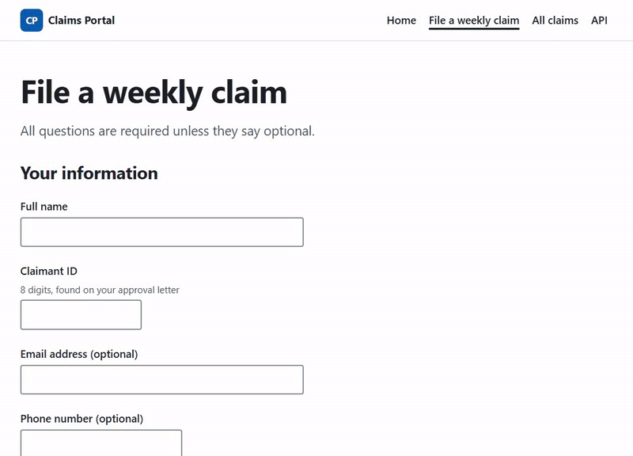
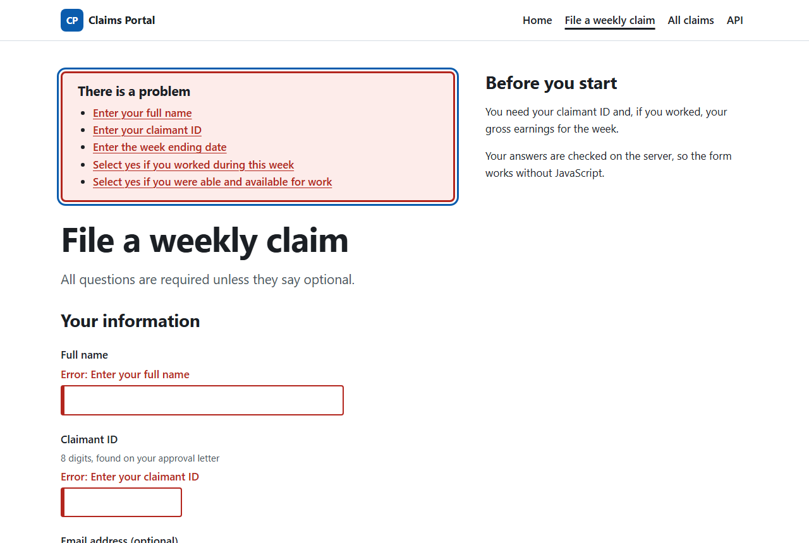
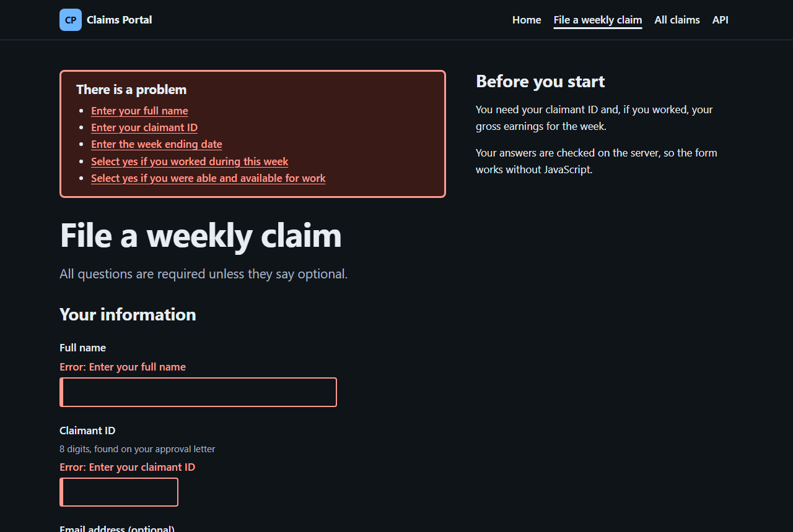
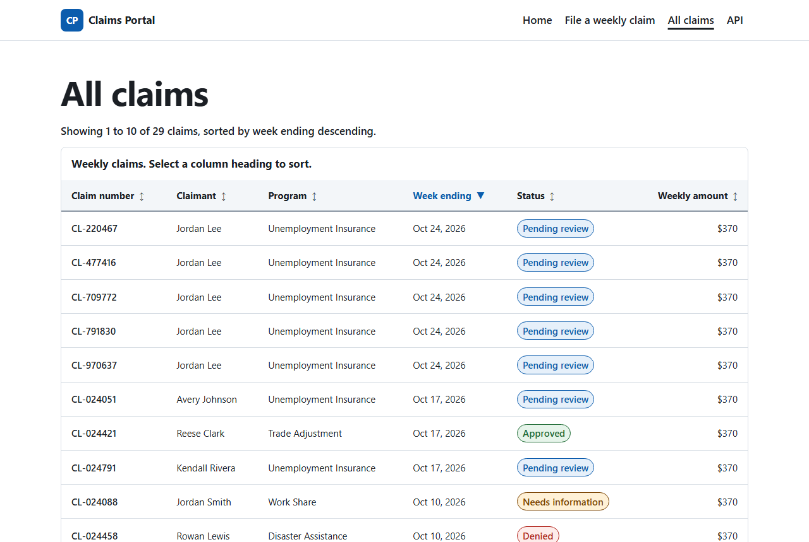
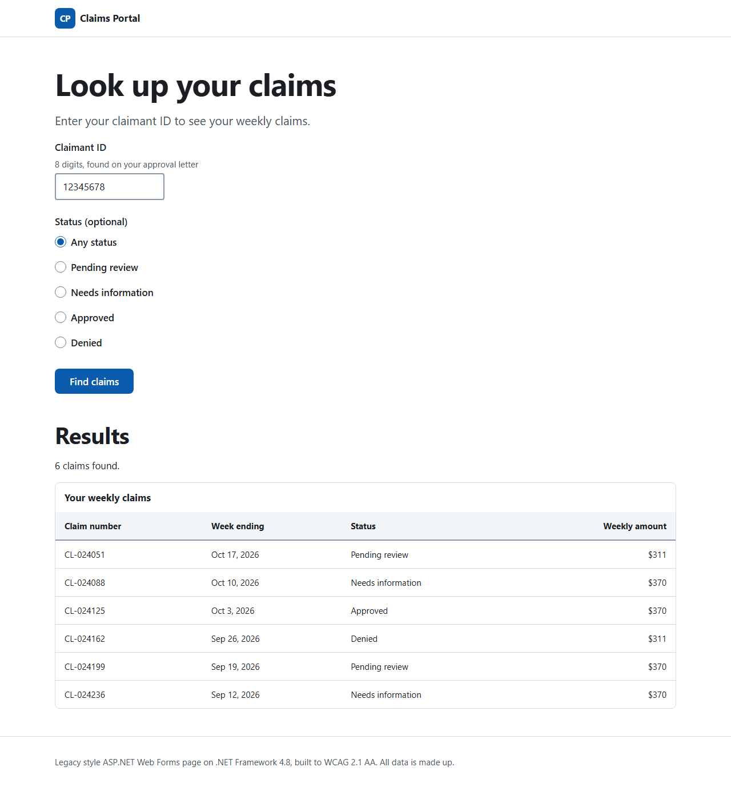
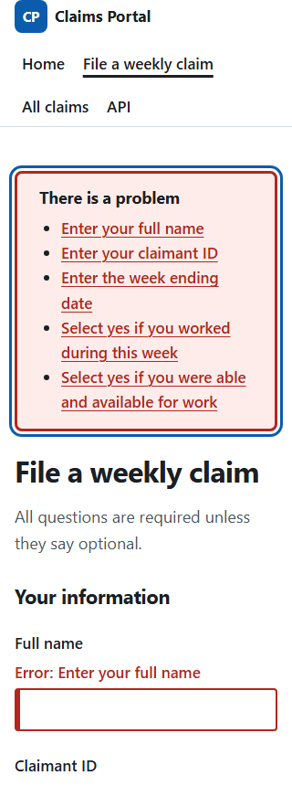

# Claims Portal (.NET code sample)

[](https://github.com/ramesh06190/claims-portal-dotnet/actions/workflows/ci.yml)


A small weekly benefit claims application I wrote to show how I build accessible, secure
enterprise apps on .NET. It pairs with my front-end portfolio at
https://ramesh06190.github.io/portfolio/ and uses the same design system.

All data is made up.

## See it without running it

Filing a claim with the keyboard only: the empty submit moves focus to the error summary, its link
takes you to the field, and the fixed form goes through.



| | |
|---|---|
|  |  |
| Error summary that takes focus and links to each field, with errors in text and not color alone | The same page in the dark theme, which is tested for contrast too |
|  |  |
| Server side sorting with `aria-sort` and paging | The Web Forms page on .NET Framework 4.8 |

The form at 320px wide, with no sideways scrolling (WCAG 1.4.10 Reflow):



## What is in it

| Project | What it shows |
|---|---|
| `ClaimsPortal.Core` | Domain model, business rules with claimant friendly messages, paging and sorting, `ClaimService` |
| `ClaimsPortal.Infrastructure` | EF Core on SQL Server with migrations and seed data, repository, transactional outbox, background dispatcher with retries |
| `ClaimsPortal.Web` | ASP.NET Core MVC with Razor, REST API with ProblemDetails and OpenAPI, custom middleware, accessibility tag helpers |
| `ClaimsPortal.WebForms` | ASP.NET Web Forms on .NET Framework 4.8, built to WCAG 2.1 AA |
| `tests/ClaimsPortal.Tests` | 52 xUnit tests: unit tests with Moq and FluentAssertions, plus API and page tests through `WebApplicationFactory` |
| `tests/accessibility` | Playwright with axe: every page and form state, keyboard behavior, and content security policy checks, in light and dark themes |

```
Browser ──► MVC controllers ─┐
                             ├──► ClaimService ──► IClaimRepository ──► EF Core ──► SQL Server
API clients ─► API controller┘          (Core)         (Infrastructure)           │
                                                                                  ▼
                                               OutboxDispatcher ◄── OutboxMessages table
                                                     │
                                                     ▼
                                     IMessagePublisher (Azure Service Bus in production)
```

## Accessibility

The MVC form works without JavaScript and follows the same patterns as the portfolio's components:

- Errors are listed in a summary at the top that takes focus and links to each field.
- The page title starts with "Error:" when there are problems, so screen reader users hear it on load.
- A custom tag helper (`AccessibleFieldTagHelper`) adds `aria-invalid` and links the error with `aria-describedby`. Out of the box ASP.NET only adds a CSS class, which assistive technology never announces.
- Error messages start with "Error:" so they do not rely on color, and the input keeps what the person typed.
- Dates use the three field "memorable date" pattern, with messages that name the missing part.
- The claims list sorts on the server, marks the sorted column with `aria-sort`, and uses links with `aria-current="page"` for pagination.

### Web Forms specifics

The Web Forms page (`Default.aspx`) fixes the accessibility problems Web Forms controls have by default:

| Default behavior | Fix used here |
|---|---|
| `GridView` renders header cells as `<td>` in the body | `UseAccessibleHeader="true"` plus `HeaderRow.TableSection = TableHeader` for `<thead>` and `<th scope="col">` |
| `RadioButtonList` renders a layout table | `RepeatLayout="UnorderedList"` inside a `fieldset` with a `legend` |
| Validators show a red asterisk with no text | `Display="None"`, then text errors and an error summary built from `Page.Validators` |
| `ValidationSummary` cannot link to fields | Custom summary in a `Repeater` with links to each field |
| Generated ids like `ctl00_MainContent_ClaimantId` | `clientIDMode="Static"` so `<label for>` and `aria-describedby` match |
| `asp:Label` renders a `span` | `AssociatedControlID` so it renders a real `<label for>` |
| Focus is lost after a postback | Focus moves to the error summary or the results heading |

### How it is tested

`tests/accessibility` runs axe (WCAG 2.1 A and AA rules) and keyboard checks with Playwright, once
in the light theme and once in dark:

- Every MVC page, plus the error state, the second page of a sorted list and the confirmation page
- The full claim form completed and submitted with the keyboard only, starting from the skip link
- The error summary taking focus, and each link moving focus to its field
- `aria-sort`, `aria-current` and 320px reflow on the claims list
- No console errors on any page, which also proves nothing is blocked by the content security policy
- The Web Forms page in its first load, error and results states, when `WEBFORMS_URL` is set

CI runs the MVC tests on every push against a SQL Server container. The Web Forms tests need IIS
Express, so I run those locally. Automated tools catch only part of WCAG, so the pages are also
checked by hand with the keyboard.

## Security

- Content Security Policy that only allows this site's scripts and styles, in both apps. The views have no inline script or style, and the tests fail on any policy violation.
- Web Forms normally writes inline postback script. The page avoids it: validators run on the server, the button does not use client validation, and focus moves from a script file.
- `X-Content-Type-Options`, `X-Frame-Options`, `Referrer-Policy` and `Permissions-Policy` headers
- Antiforgery tokens on MVC form posts, and `ViewStateUserKey` on the Web Forms page for the same protection
- Correlation IDs on every request, only reused from the caller when they are safe to log
- Unhandled API errors return ProblemDetails with a correlation ID and never the exception message or stack trace. Pages show a friendly error page instead. Both are covered by tests.
- The list API leaves out claimant IDs and contact details
- NuGet audit fails the build on vulnerable packages. A transitive `System.Security.Cryptography.Pkcs` from SqlClient is pinned to a patched version for that reason.
- Web Forms removes `X-Powered-By` and `X-AspNet-Version`, uses HttpOnly SameSite cookies and encrypted view state

## API

| Method | Route | Notes |
|---|---|---|
| GET | `/api/claims?page=1&pageSize=10&sort=Claimant&direction=Ascending` | Paged list. Sort by `Submitted`, `ClaimNumber`, `Claimant`, `Program`, `WeekEnding`, `Status` or `Amount`. |
| GET | `/api/claims/{claimNumber}` | One claim, or a 404 ProblemDetails |
| POST | `/api/claims` | Files a claim. Returns 201 with a Location header, or 400 ValidationProblemDetails with an error per field. |

The OpenAPI document is at `/openapi/v1.json`.

## Run it

Needs the .NET 10 SDK and SQL Server LocalDB (installed with Visual Studio).

```bash
dotnet run --project src/ClaimsPortal.Web
# http://localhost:5272 - the database is created and seeded on first run in Development
```

Unit and integration tests use in-memory SQLite, so they need no database:

```bash
dotnet test ClaimsPortal.slnx --settings coverage.runsettings --collect "XPlat Code Coverage"
```

Accessibility tests start the app themselves on port 5290 (Node 20 or later):

```bash
cd tests/accessibility
npm install
npx playwright install chromium
npm test

# To include the Web Forms page, start it in IIS Express first, then:
WEBFORMS_URL=http://localhost:5291/ npm test
```

`npm run screenshots` recreates the images in `docs/images` while both apps are running.

The Web Forms project needs Visual Studio's MSBuild (it is not part of `ClaimsPortal.slnx` for that reason).
Open `src/ClaimsPortal.WebForms/ClaimsPortal.WebForms.csproj` in Visual Studio and run it with IIS Express.

## CI

GitHub Actions (`.github/workflows/ci.yml`) runs three jobs on every push:

1. **Build and tests.** Warnings are errors with the recommended .NET analyzers. It fails on vulnerable packages, checks the EF Core model has no unapplied changes, runs the tests, and fails if line coverage drops below 85%. The coverage summary is shown on the run page.
2. **Accessibility.** Starts the app against a SQL Server 2022 container and runs the axe and keyboard tests in both themes.
3. **Web Forms.** Builds the .NET Framework 4.8 project on Windows.

`azure-pipelines.yml` has the same build, test and coverage checks for Azure DevOps, and publishes
results to the pipeline's Tests and Code Coverage tabs.
